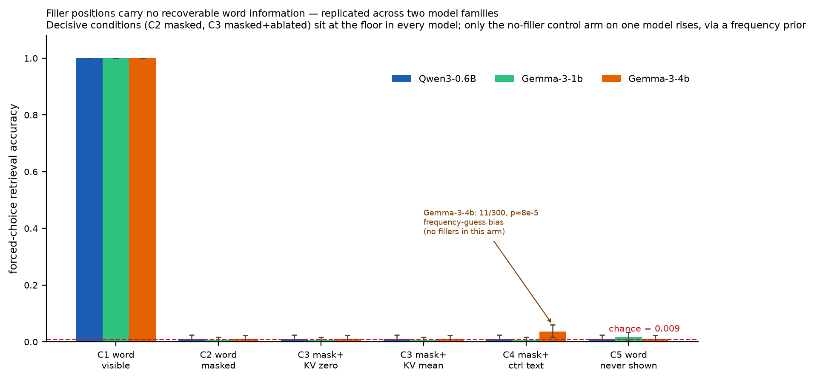
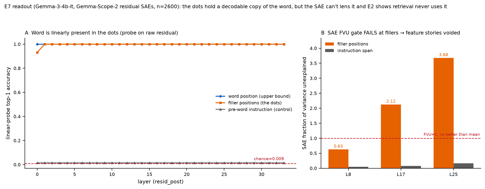
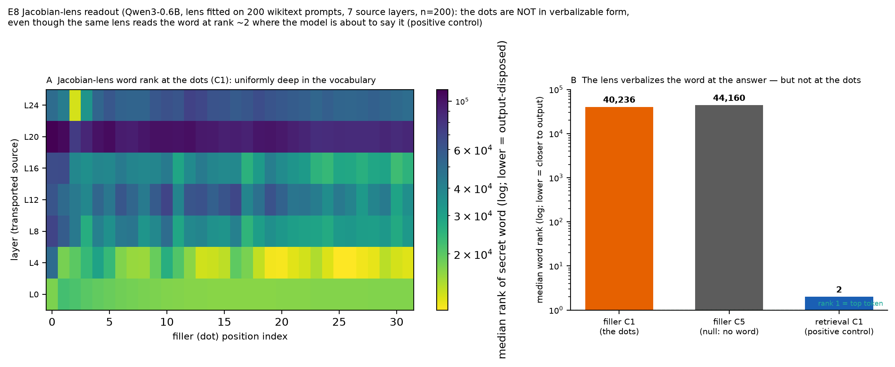
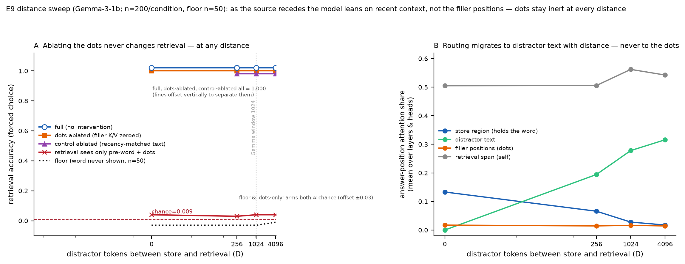
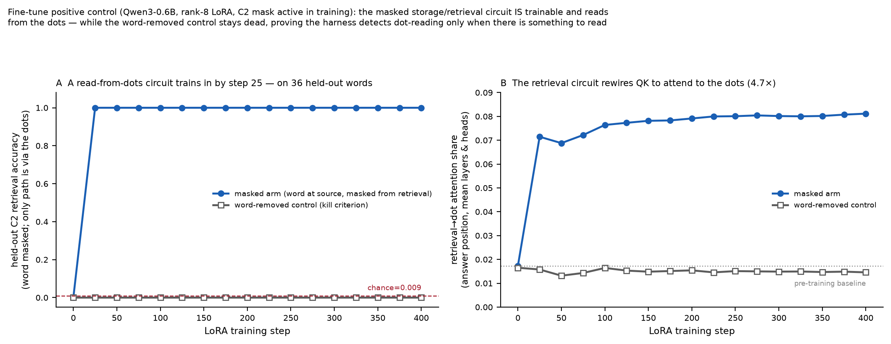
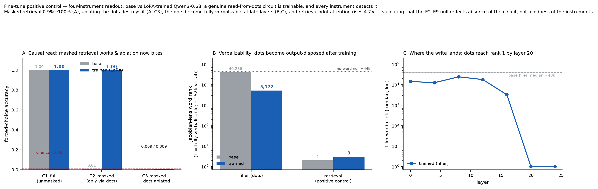
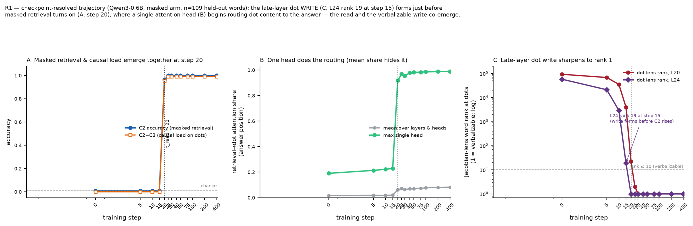
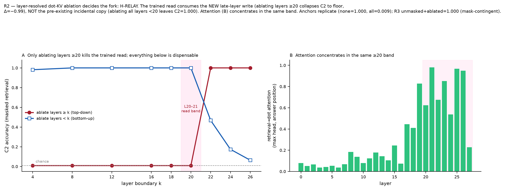
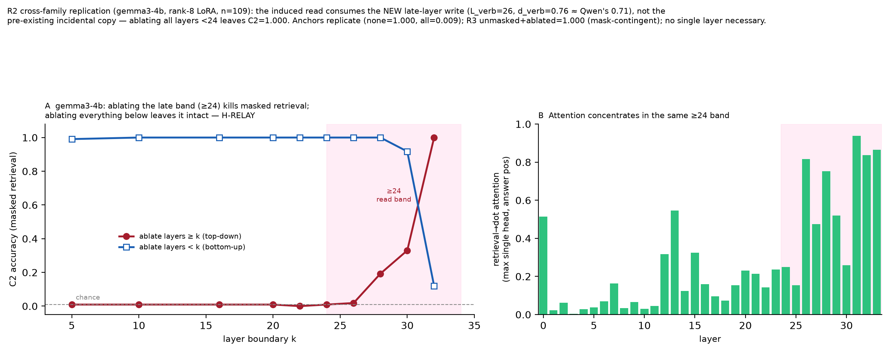

# Do language models store and retrieve information through filler ("dot") tokens?

**An absence-with-mechanism report across two model families and four readout instruments.**

*Working draft (August 2026) — companion to the experiment logs in `RESULTS.md`. All numbers
below are reproduced from the saved result artifacts (parquet + summary JSON);
the figures track their latest saved versions.*

---

## Abstract

A claim circulating about frontier chat models is that they can *store*
information in the residual activations at filler-token ("dot") positions during
a deliberate pause and *retrieve* it later — a literal "scratchpad in
dot-space." We tested the strong, mechanistic version of this claim on
off-the-shelf instruct models with a store→pause→retrieve task and an attention
mask that forces the *only* causal path from the secret word to the answer to
run through the filler positions. Across three models and two tokenizer families
(Qwen3-0.6B, Gemma-3-1b, Gemma-3-4b), retrieval is at ceiling when the word is
visible (100%) and collapses to chance the moment the word token is masked —
even though the filler positions remain fully attendable. Zero- and mean-KV
ablation of the filler positions is a no-op. So the behavioral answer is a clean
**no**: these models do not read the answer from the dots.

Four complementary readout instruments then localize *why*. The word **is**
linearly present in the dot residuals (~100% decodable by a probe, an incidental
copy deposited by attention to the visible word), but it is **not** in
verbalizable/output-disposed form (a Jacobian lens that ranks the word ~2 out of
~150k where the model is about to say it cannot find it at the dots), it is
**not** carried by interpretable sparse features (the SAE is off-distribution on
32 identical dots; FVU>1 voids feature claims), and it **never becomes
load-bearing** even when up to 4096 tokens of distractor text separate storage
from retrieval — attention migrates to recent *text*, never to the dots. The
unified picture: an incidental linear copy sits in the dots, but it is neither
output-disposed, causally read, nor recruited at range. This is a sharper result
than a flat behavioral null — we can say precisely what is in the dots, what is
not, and why the null holds.

Finally, a fine-tune **positive control** closes the methodological gap. Rank-8
LoRA on the same task, with the same C2 mask active during training, induces a
genuine read-from-dots circuit in Qwen3-0.6B (masked-retrieval accuracy
0.9%→100% on held-out words) while a word-removed kill control stays dead at
floor. On the trained model every instrument fires: ablating the dots now
destroys the answer (a no-op before), retrieval→dot attention rises 4.7×, and
the dot residual becomes fully verbalizable at late layers. This converts the
E2–E9 null from *absence of evidence* into *evidence of absence* — the
instruments detect the circuit the moment it exists, so the off-the-shelf null
is a property of the models, not a blind spot of the method. Two preregistered
resolver runs (§5.5) settle what LoRA supplied: not a read against the word's
pre-existing incidental copy (our original guess, refuted) but a **write-read
relay** — training builds a genuine new store at the late-layer dot positions and
a read that consumes it, while the pre-existing copy proves dispensable
(layer-resolved ablation localizes the load-bearing store to the top ~20% of the
stack; ablating everything below leaves masked retrieval intact). This resolution
replicates across two tokenizer families and a 7× size gap: on both Qwen3-0.6B
and gemma3-4b the fork resolves to H-RELAY, and the store's *relative* depth
converges (d_verb 0.71 vs 0.76).

The induction cost is worth stating plainly: a rank-8 LoRA (2.29M parameters,
0.38% of the model) reaches perfect masked retrieval within ~25 steps — a covert
relay through innocuous filler tokens is trivially cheap to train in — and the
same four instruments detect it immediately, which is the defensively relevant
half of the result.

We report what remains genuinely open (parallel-compute benefits; scale above
27B; narrative "basin" contexts) and preregister the experiments that would
close each.

---

## 1. The claim, and what would count as testing it

The originating claim bundles several distinct propositions that are worth
separating before any experiment:

1. **Parallel compute.** Filler tokens give the model extra parallel width — more
   forward-pass positions to compute over. *(Well-supported in the literature;
   not what we test here.)*
2. **Causal storage/retrieval.** The model writes task-relevant information into
   the residual stream at filler positions and a later retrieval circuit reads it
   back — a genuine memory relay through the dots.
3. **Reconstruction.** The model reconstructs the answer from surrounding context
   at retrieval time and the dots are incidental.

Proposition 2 is the strong, mechanistic, falsifiable claim, and it is the one
this project targets. The methodological core is an **attention mask that removes
proposition 3 as an escape route**: if the retrieval query is forbidden from
attending to the original word token but permitted to attend to the filler
positions, then any above-floor retrieval *must* route through the dots. That
turns "can the model still answer?" into a direct causal test of storage.

---

## 2. Task and method

**Task.** Each trial is assembled from tokenized segments (never by substring
search on a decoded string, which would corrupt span bookkeeping):

```
Remember this secret word: <WORD>. <32 identical filler tokens> .
What was the secret word? Answer with one word. The secret word is ___
```

The secret word is a single-token word drawn from a filtered vocabulary; the
filler is a single repeated token (`" ."`, id 659 for Qwen3; id 783 for Gemma).
Retrieval is scored by forced choice over the candidate-word vocabulary at
temperature 0.

**Conditions.**

| condition | what it does | role |
|---|---|---|
| C1_full | no intervention | ceiling |
| C2_word_masked | retrieval cannot attend to the word token; dots fully attendable | the decisive test |
| C3_masked+ablated | C2 + filler KV zero- or mean-ablated | ablation control |
| C4_control_text | word replaced by position/RoPE-matched control text (no fillers) | reconstruction control |
| C5_floor | word never shown | leakage floor |

**The mask is an allowlist on `hook_attn_scores`**, and — verified in
`build_block_mask` — it rewrites *only* the retrieval-query rows. This has a
consequence that matters for interpreting E7 below: the filler-position
residuals are **bit-identical between C1 and C2**. Masking changes what the
retrieval query may look at; it does not change what the dots contain.

**Gates.** Every model must pass three E0 sanity gates before any experiment is
trusted: ceiling ≥ 0.90 (C1), floor ≤ 3×chance+0.02 (C5), and no-leakage (the
masked+ablated condition stays at floor). All models below pass all three.

**Stack.** TransformerLens for the masked/ablation/probe work (Qwen3-0.6B on CPU
for $0; Gemma on a single Modal A10G GPU, weights read offline from a volume).
The Jacobian-lens readout (E8) is TransformerLens-free and runs on plain
HuggingFace.

---

## 3. The decisive behavioral result (E2), replicated across families

Masking the word collapses retrieval to the floor, and ablating the fillers does
nothing, in every model tested:

| condition | Qwen3-0.6B (n=200) | Gemma-3-1b (n=300) | Gemma-3-4b (n=300) |
|---|---|---|---|
| C1_full | **1.000** | **1.000** | **1.000** |
| C2_word_masked | 0.010 | 0.007 | 0.010 |
| C3_masked+zero-ablated | 0.010 | 0.007 | 0.010 |
| C3_masked+mean-ablated | 0.010 | 0.007 | 0.010 |
| C4_control_text | 0.010 | 0.007 | 0.037¹ |
| C5_floor | 0.010 | 0.017 | 0.010 |

chance = 0.009 (Qwen3), 0.0087 (Gemma).

¹ The one non-floor cell: Gemma-3-4b C4 = 11/300 (binomial p ≈ 8×10⁻⁵ vs
chance). It is **not** filler storage — C4 is the control-text arm and contains
*no filler tokens at all*. The 11 hits concentrate on 4 high-frequency words
(winter ×5, meadow ×3, morning ×2, evening ×1; only 3 distinct predicted
tokens), and the mean logit margin stays deeply negative (−12.2 vs −14.0 floor).
It is a lexical-frequency guessing bias, not a channel.



**Reading.** When the word is visible the model answers perfectly. The instant
the word token is masked — with the dots still fully attendable — retrieval falls
to chance, and it stays there whether or not the filler KV is ablated. There is
no causal path from the secret word to the answer that runs through the dots.
Proposition 2 is refuted for these models.

---

## 4. Four instruments localize the mechanism

A behavioral null says the dots aren't *used*. It does not say what, if anything,
is *in* them. Four readouts answer four different questions at the filler
positions, and the dissociations between them are the actual finding.

### 4.1 Is the word linearly present? — E7 probe: **yes, ~100%**

A multinomial linear probe (PCA-256 → logistic regression) trained on the raw
residual at each layer recovers the secret word from the filler positions at
**~100% accuracy from layer 1 onward** (0.931 at L0), against a label-shuffle
null of p95 = 0.015 and a pre-word instruction-position baseline pinned at chance
(0.015). So the word is physically, linearly there.

This is not in tension with E2 — it is the sharp version of it. Because the C1
and C2 filler residuals are bit-identical, we know: the word sits in the dots
(an incidental copy deposited by attention to the still-visible word), the
retrieval query in C2 *is allowed* to attend to those dots, and retrieval still
collapses to floor. **The retrieval circuit reads the word from its source
position, not from the dot-copy.** The dots are not empty; they are functionally
inert for retrieval.



### 4.2 Is it carried by interpretable features? — E7 SAE: **unanswerable here**

Running Gemma-Scope-2 SAEs at the filler positions gives a fraction-of-variance-
unexplained (FVU) of 0.63 (L8), 2.13 (L17), 3.68 (L25). FVU>1 means the SAE
reconstructs the filler residual *worse than predicting the mean* — 32 identical
dot tokens are off the natural-text distribution the SAE was trained on. Per the
project's standing rule (high filler FVU voids feature stories), **no
feature-level claim is made.** The astronomically large word-discriminative
F-statistics (10¹⁰–10¹³) are an artifact of near-zero JumpReLU codes collapsing
within-word variance, not a finding. The trustworthy lens is the linear probe on
the raw residual.

### 4.3 Is it in verbalizable form? — E8 Jacobian lens: **no**

The linear probe shows the word is *decodable*; E8 asks whether it is in
*output-disposed* form — the kind of content the model is disposed to actually
emit. A Jacobian lens (fitted once on ~200 wikitext prompts) transports a
residual into the final-layer basis and decodes through the unembedding.

| site | condition | median word rank (vocab ≈ 150k) |
|---|---|---|
| filler positions | C1_full | 40,236 |
| filler positions | C5_floor (word never shown) | 44,160 |
| **retrieval / answer position** | **C1_full — positive control** | **~2 (layer 24)** |

The filler-position rank in C1 is statistically indistinguishable from the
no-word null; even the single best (layer, dot) cell is rank 11,076 vs 10,933 in
C5. **The dots are not in verbalizable form.** What makes this a *real* null
rather than a weak instrument is the positive control: the same lens ranks the
word **~2 out of ~150k** at the retrieval positions where the model is genuinely
about to say it. The instrument works; the dots are simply not output-disposed.



*(OOD caveat: the Jacobian is averaged over natural text and 32 identical dots
are off that distribution. The null means "no linearly-transported verbalizable
content"; the positive control bounds but does not fully eliminate this concern.)*

### 4.4 Does it become load-bearing at range? — E9 distance sweep: **no, to 4096 tokens**

E2/E7 used minimal context. E9 inserts D ∈ {0, 256, 1024, 4096} tokens of
distractor conversation between storage and retrieval — crossing Gemma's
1024-token sliding-attention window, the regime where recency bias could make a
recent dot-copy cheaper to route to than the distant source.

| D | full | dots ablated | control ablated | dots-only retrieval | floor |
|---|---|---|---|---|---|
| 0 | 1.000 | 1.000 | — | 0.010 | 0.000 |
| 256 | 1.000 | 1.000 | 1.000 | 0.000 | 0.000 |
| 1024 | 1.000 | 1.000 | 1.000 | 0.010 | 0.000 |
| 4096 | 1.000 | 1.000 | 1.000 | 0.010 | 0.020 |

**delta_dots = delta_ctrl = 0 at every distance.** Ablating the filler KV is a
no-op even at D=4096; so is ablating a recency-matched block of neutral text. The
preregistered prediction (dots become load-bearing at range) is refuted.

The attention shares supply the mechanism. As D grows, answer-position attention
to the store region decays (0.133 → 0.018) and attention to the distractor block
grows (0 → 0.316) — routing *does* migrate with distance. But it migrates to the
distractor **text**; the filler share stays flat at ~0.015 throughout. As the
source recedes the model leans on recent context, never on the pause.



---

## 5. The four-readout taxonomy

| Instrument | Question at the dot positions | Answer (off-the-shelf models) |
|---|---|---|
| E2 / E3 — masking, ablation | Is the content *causally read* at retrieval? | **No** |
| E7 (E4) — linear probe | Is the word *linearly present* at all? | **Yes**, ~100% |
| E7 — SAE features | Carried by *interpretable sparse features*? | **Unanswerable** (FVU>1) |
| E8 — Jacobian lens | In *verbalizable, output-disposed* form? | **No** (rank ≈ null; control ≈ 2) |
| E9 — distance sweep | *Load-bearing* at range? | **No** (Δ=0 to D=4096) |

**Unified picture.** The secret word leaves an incidental linear copy in the
filler positions via attention to the visible word. That copy is not in
output-disposed form, is never causally read by the retrieval circuit, and never
becomes load-bearing even when the source is thousands of tokens away. The model
retrieves by reading the source directly at short range and leaning on recent
context at long range — never through the dots. This is a precise, multiply-
triangulated refutation of the strong "store-in-dot-space, retrieve-later" claim
for off-the-shelf instruct models, and it is *sharper* than a flat behavioral
null: we can name what is in the dots (a linear copy), what is not
(verbalizable/retrievable content), and why the behavioral null holds (the
retrieval circuit reads elsewhere).

---

## 5.5 The positive control: is the null real, and does the model read-off or write?

Everything above is an *absence*. The strongest objection is methodological: the
instruments might simply be blind to filler storage. We close that gap by
**manufacturing the circuit E2–E9 failed to find** and confirming every
instrument detects it.

**Design.** A rank-8 LoRA adapter (q/k/v/o projections; 2.29M trainable
parameters, 0.38% of Qwen3-0.6B) is trained on the store→pause→retrieve task
**with the C2 block-mask active in the forward pass**. Under that mask the
retrieval query cannot attend to the source word, so the only gradient path to
the answer token runs through the filler positions — where E7 showed the word is
*already* ~100% linearly present as an incidental copy. Critically, the training
mask is the *same* mask the instruments use: the 4D HuggingFace additive mask is
verified byte-for-byte equal to TransformerLens's effective mask (causal AND the
`build_block_mask` allowlist), so training and readout cannot drift apart.

Two arms guard interpretation. The **masked** arm has the word present at source
but masked from retrieval — learnable only if a read-from-dots circuit can form.
The **word-removed** arm (kill control) deletes the source word under the same
mask; there is nothing to route, so it must stay at floor. *If it rises, the
harness leaks and the masked-arm gain is uninterpretable.*

**The kill control passes.** Across 400 steps the word-removed arm's loss never
drops below 4.38 and held-out C2 accuracy stays pinned at 0.000 — no
memorization, no mask hole. The masked arm, by contrast, reaches **C2 = 1.000 by
step 25** on 36 words never seen in training: a general read-from-dots circuit,
not lookup.



**Four-instrument readout, base vs LoRA-merged model** (n=109 held-out words,
chance 0.009):

| Instrument | base | trained | reading |
|---|---|---|---|
| E2 C1_full (unmasked) | 1.000 | 1.000 | ceiling intact |
| E2 **C2_word_masked** | 0.009 | **1.000** | masked retrieval now works — via the dots |
| **C2→C3 collapse under dot ablation** | 0.009 → 0.009 (Δ = 0.000) | **1.000 → 0.009 (Δ = −0.991)** | **ablation now bites**: the trained retrieval is destroyed by zeroing filler KV; the base model never depended on it |
| retrieval→dot attention¹ | 0.017 | **0.081** | QK rewired 4.7× toward the dots (mean share; head-level in R1) |
| E8 lens filler word-rank (median)² | ~40,236 | **5,172** | dots move toward output-disposed form |
| E8 lens filler rank, layers 20/24² | ~40k | **1** | a NEW verbalizable representation at late-layer dots |
| E8 lens retrieval (positive control) | ~2 | ~3 | lens still valid |



¹ Attention-share row from the per-checkpoint tracking run
(`eft_finetune.evaluate`, mean over layers & heads of answer-position attention
onto the filler span): "base" = step 0 (LoRA-B zero-initialized ⇒ identity),
"trained" = step 400; the word-removed control stays flat (0.017→0.015). Other
rows are from the base-vs-LoRA-merged readout.

² **Lens transport (F2).** The "trained"-column lens ranks apply the Jacobian
transport fitted on the *base* model to merged-model residuals, so the transport
is mildly mis-specified for the trained network. Rank 1 at L20/24 survives this
(bounded by a final-model refit in R1); read intermediate ranks as ordinal.

(The per-checkpoint linear probe is uninformative in this readout: with one
deterministic example per word-class, in-sample logistic regression is trivially
separable for any labelling, base and trained alike. The "word linearly present
at the dots" question was already settled by E7 at n=2600.)

**Verdict — a genuine read-from-dots circuit; mechanism fork pending.** Trained
only on the answer token, the model rewires attention toward the dots
(0.017→0.081), makes the dots causally load-bearing (Δ flips 0.000→−0.991), and
develops a new output-disposed representation at late-layer dot positions (lens
rank → 1 by L20 — a representation the base model's incidental copy never had).
Two mechanisms fit this end-state equally: a **read-off** of the pre-existing
incidental copy (with the late verbalizable write as a side-effect of optimizing
the output token), or a **write-read relay** in which training built the late
write and the read consumes *it*, with the incidental copy as scaffolding at
most. The end-state data cannot distinguish them.

**Preregistered fork (committed before the resolvers ran).** We define
L_verb = earliest dot layer with trained median lens rank ≤10 (=20), t_read =
earliest checkpoint with C2 ≥0.95, t_verb = earliest checkpoint with lens rank
≤10 at any layer ≥ L_verb−2. Two resolver runs decide it: **R1** (rerun training
with dense checkpoint saves; read out C2, the C2−C3 causal delta, attention, and
per-layer lens rank at each checkpoint — does accuracy lead late-layer
verbalizability, or co-emerge?) and **R2** (layer-resolved dot-KV ablation on the
trained model — H-RELAY if ablating only layers ≥ L_verb−2 collapses C2 while
ablating only below leaves it ≥0.90; H-READ if the reverse; distributed
otherwise). The test is clean because KV ablation at layer *k* removes only what
queries read *from* the dots at layer *k*, never the dots' own residual stream,
so the early copy and the late write dissociate.

**Resolved — H-RELAY.** Both resolvers ran after the preregistration was
committed; anchors and kill criteria passed (R1: C2 = 1.000 by step 25; R2:
no-ablation 1.000, all-layer ablation 0.009). **R2 is decisive:** ablating dot KV
only at layers ≥ 20 collapses masked retrieval to floor (1.000 → 0.009), while
ablating *all* layers < 20 leaves it fully intact (1.000). The load-bearing store
is the new late-layer write; the pre-existing incidental copy (early/mid layers,
~100% decodable from step 0) is dispensable. Attention concentrates in the same
≥20 band, no single layer is individually necessary (the write is redundant
across the band), and R3 (unmasked + full dot ablation = 1.000) shows the circuit
is engaged only when the direct route is blocked. **R1** is consistent: the L24
dot lens rank reaches 19 at step 15 — while C2 is still at floor — then rank 1 as
C2 turns on at step 20, with a single attention head (max-head share 0.19→0.92)
doing the routing that the mean share obscured.





**This corrects the mechanism we preregistered.** Before the resolvers we
inferred "read-off, then write" — a read against the pre-existing copy with the
verbalizable write as a downstream side-effect. R2 refutes it: the pre-existing
copy is not what is read. Training builds a genuine **new store** at the late dot
layers and a read that consumes *that* — a write-read relay. Because the fork and
its decision rules were committed before the runs, this is a corrected finding
rather than a post-hoc narrative. (The late depth of this induced *storage* write
contrasts sharply with the *early*-layer locus of the filler *computation*
benefit reported by Baherwani et al.; see §6.5 — computation-via-fillers is
early, storage-via-fillers is late.)

**Why the two representations dissociate: input-format vs. output-format.** The
reason ablating the late layers collapses retrieval while ablating everything
below does nothing is that the incidental copy and the trained write are in
*different formats*. The incidental copy (early/mid layers, present from step 0)
is **input-flavoured** — a residue of "the word I was shown." A probe decodes it,
but the lens places it nowhere near output form: it is a smudge of the input. The
trained write (late layers, lens rank 1) is **output-flavoured** — it sits in the
"about to say this token" direction. That is not a copy of the word so much as
*the answer, precomputed*. So the plainest statement of the mechanism: training
taught the model to do the retrieval work *early*, during the pause, and stash
the finished answer at the dot positions; at question time it fetches the
pre-computed answer instead of re-deriving it from the source. The dots do not
hold "the word I was told" — they hold "the word I am going to say." This is why
R1's ordering is what it is (the write is deposited at step 15, before anything
reads it), and why R3 is a no-op (unmasked, the model ignores the stash and reads
the source directly — the relay is opportunistic, not compulsory).

**A methodological aside — report the max head, not just the mean.** The
retrieval→dot attention mean share barely moved over training (0.017 → 0.08),
which on its own would read as "attention hardly changed." But the *max single
head* went 0.19 → 0.92: one head carries essentially all of the routing, and
averaging over ~16 heads and 28 layers nearly buried it. A replication that
reported only the mean-over-heads share would have missed the routing circuit
entirely. When a single head is expected to carry a mechanism, the mean is a
blunt proxy; report the head-level number alongside it.

**Preregistered cross-family replication (gemma3-4b).** The mechanism above is
established on one model (Qwen3-0.6B); the null it validates spans two families,
so before publishing we replicate the fork resolution on gemma3-4b (34 layers)
and commit the decision rule in advance. The rule is defined on the trained 4b
model, not ported by absolute index: `L_verb` = earliest dot layer with median
lens word-rank ≤ 10; `d_verb = L_verb/34` (Qwen reference 20/28 = 0.71); at
boundary `b = L_verb−2`, **H-RELAY replicates** if ablating layers ≥ b collapses
masked retrieval to ≤ 3×chance while ablating all layers < b spares it (≥ 0.90),
**H-READ** if the reverse (a model-dependent mechanism, reported as such), else
**distributed**. We report whether `d_verb` lands within ±0.1 of 0.71 —
convergence in relative depth would be the stronger cross-family claim. Chance is
recomputed on the Gemma tokenizer; the same word-removed kill control gates
interpretability. Gemma adds three Phase-0 gates absent on Qwen: text-backbone
loading (`n_layers==34`), `attn_implementation="eager"` for the head-level metric,
and byte-for-byte verification that our C2 mask combines with Gemma-3's
sliding-window mask (checked separately for local and global layers).

**Result — H-RELAY replicates on gemma3-4b.** All gates passed (n_layers==34;
eager attention; the C2 mask combines byte-for-byte with Gemma's sliding-window
mask — zero leaked attention onto any blocked key on all 22 local and 4 global
layers). One trap closed along the way: `gemma-3-4b-it` is multimodal, and the
naïve text-loading path silently returns random weights, so training and readout
both route through a verified weight transplant. Training reproduced the Qwen
pattern exactly (kill control pinned at floor; masked arm to C2=1.000 by step 25
on held-out words). The R2 sweep resolved the fork to **H-RELAY** a second time:
ablating dot KV at layers ≥24 collapses masked retrieval to floor while ablating
all layers <28 leaves it at 1.000 (anchors 1.000/0.009; no single layer
necessary; R3 unmasked+ablated = 1.000). L_verb = 26 of 34, so **d_verb = 0.76 —
within 0.055 of Qwen3-0.6B's 0.71**: the load-bearing store sits in the top ~20%
of the stack in both models. The induced read consumes a new late-layer write,
not the pre-existing incidental copy, across two tokenizer families and a 7×
size gap — so the mechanism claim no longer rests on a single model.



**What this does for the null.** It converts E2–E9 from *absence of evidence*
into *evidence of absence*. The identical instruments, on an identical task and
mask, cleanly detect a read-from-dots circuit the moment one is trained in — so
the off-the-shelf null is a property of the models, not a blind spot of the
method.

---

## 6. Scope and what remains open

The result is scoped to **off-the-shelf instruct models up to 4B parameters, in
the default assistant distribution, at short-to-moderate range.** Three things
are genuinely *not* refuted, and each is directly testable.

**6.1 Parallel compute (proposition 1).** Untested here and a different claim.
Filler tokens plausibly add parallel width; nothing above bears on it.

**6.2 Scale.** The serial-compute limit is architectural and scale-invariant —
no information passes through the *sampled identity* of a dot token at any size.
But whether a retrieval-time circuit *reads from dot-position KV* is a learned
property, not architecturally forbidden. It could emerge with the training mix
that covaries with scale (heavy RL, long-conversation and reasoning-mode
training). A 270M→27B sweep is the right instrument: a flat-zero trend across two
orders of magnitude is the strongest purchasable evidence, and it puts the burden
on the scale hypothesis to explain why the effect would be exactly zero until it
isn't. Honest scope line: **untested above 27B.** *(Note: near-frontier causal
testing is now an engineering problem, not an access problem — open-weight MoEs
at 600B–1T exist; KV-ablation needs custom serving-stack hooks, not
TransformerLens.)*

**6.3 The narrative "basin."** Our experiments ran in a sterile instruction
frame. The original phenomenology lived in long, self-referential, narratively
charged contexts where the pause has been *assigned meaning*. A mechanical fact
bounds this: for a fixed token sequence, self-generated and teacher-forced dots
are computationally identical — spontaneity per se is not a separate mechanism.
But spontaneity *marks* a region of context space where attention patterns and
active features differ, and it is coherent that dot-directed retrieval attention
could wake up under a narrative frame while staying dark in ours. This is E10,
below.

---

## 6.5 Related work: filler tokens for computation vs. storage

Concurrent to this work, Baherwani et al. (2026) study filler tokens from the
**computation** side: they show that frontier models can exploit semantically
irrelevant filler tokens to do additional parallel forward-pass work, improving
accuracy on synthetic reasoning tasks (multiplication, multi-step arithmetic,
variable counting) by up to ~13 points, with the effect depending jointly on
token type, task, and few-shot context. This is the modern, frontier-scale
confirmation of the parallel-compute reading of filler tokens (Pfau et al.,
2024) — the claim we bracketed from the outset as *separate from, and not in
tension with*, the storage-and-retrieval claim this paper tests. Their results
and ours are complementary halves of "what filler tokens do," and four points of
contact are worth making explicit.

**The probe-vs-use dissociation replicates at 235B.** On Qwen3-235B, Baherwani
et al. train linear probes on filler-span activations and can decode the task
answer, but note that decodability does not establish that the model *uses* that
information. This is precisely the dissociation our E7 draws at 0.6B: the secret
word is ~100% linearly decodable from the dot positions (probe), yet is not read
at retrieval (E2 causal mask) and not output-disposed (E8 lens). That the same
present-but-not-necessarily-used gap appears independently on both the
computation axis (theirs, 235B) and the storage axis (ours, 0.6B) suggests it is
a general property of filler-span representations, not an artifact of scale or
task. Probes over filler positions overstate functional use in both regimes;
causal tests are required.

**A depth double dissociation.** Their activation patching localizes the
*computation* benefit to **early** layers: patching filler activations at layers
0–30 (of 94) recovers >90% of the effect, while late-layer (70+) patches give
negative recovery, and they note the signal is distributed across the filler span
and "originates in early layers." Our induced *storage* circuit is the opposite:
the load-bearing write and the read that consumes it localize to **late** layers
(≥ ~0.71 relative depth; layer-resolved ablation, §5.5). Computation-via-fillers
is an early-layer phenomenon; content-storage-via-fillers, when trained in, is a
late-layer one. Two distinct uses of the same token positions, at different
depths — a clean boundary that neither paper draws alone.

**Off-the-shelf vs. induced, and which training pressure matters.** Baherwani et
al. find the *computation* benefit is already present in frontier models with no
extra training, but that neither RL (which reshaped Qwen3-235B's filler-type
preferences without a persistent test-time benefit) nor SFT induced *more* of it.
Our *storage* result is the mirror image: the capability is **absent** off the
shelf (E2–E9, three models, two families) and must be trained in — but a
supervised objective in which the filler path is the *only* gradient route to the
answer induces it in ~25 steps with a rank-8 LoRA. The contrast is informative
about *what kind* of pressure elicits invisible mechanisms: their RL/SFT, with no
filler-targeted gradient, did not build a persistent filler benefit; our masked
objective, which forces the gradient through the filler span, built a causal
storage circuit. Pressure that routes the objective through the filler positions
is the operative ingredient, not optimization intensity per se.

**Safety framing, combined.** Baherwani et al. give the computation-side
demonstration that invisible reasoning can serve an objective hidden from a CoT
monitor — filler tokens let a deployed model satisfy a hidden modular-arithmetic
constraint, lifting the unobservable step from 33.5% to 44.5%. Our result adds
the storage-side, cost-quantified companion: a covert store-and-retrieve relay
through innocuous filler positions is inducible with 2.29M LoRA parameters in ~25
steps — and is detected immediately by the same four activation-level instruments
that a token-level monitor would miss. Together: hidden computation *and* hidden
storage are both reachable through filler positions, both invisible to
output-token monitoring, and both visible to activation-level probes — which is
the constructive half of the safety message.

**A caution we adopt from them.** They observe that on zero-shot multiplication
the filler benefit survives even when the filler span cannot attend to prior
context, and attribute it partly to attention redistribution and positional
effects rather than question-specific computation. We read this as support for
our insistence on position-matched controls (C4's equal-length neutral text;
E9's recency-matched neutral-token ablation): filler effects can be positional
artifacts, and only substrate-matched contrasts isolate the mechanism.

Baherwani et al. is an unreviewed preprint (v1, 24 Jul 2026); several models it
references sit at or after this project's horizon, so we treat specific figures
as provisional and cite as a preprint. Reference: Baherwani, V., Goldstein, T.,
and Panda, A. (2026). *Not All LLM Reasoning is Visible in the Chain-of-Thought.*
arXiv:2607.22925v1 [cs.CL].

---

## 6.6 Why the frontier-API behavioral route cannot test dot-space storage

A natural question is whether the storage signature appears at frontier scale,
where we have no access to weights, activations, or the KV cache. We built a
provider-agnostic behavioral battery (`e11_api_battery.py`, store→pause→retrieve
with a substrate × length factorial, on claude-sonnet-5 and gpt-5.6-terra) to
find out, and a calibration pilot surfaced a structural reason the behavioral
route cannot address the claim. We record it here because the reason is more
useful than a table of ceiling scores would have been.

**The stateless-recomputation problem.** An API call is stateless: the whole
transcript is re-tokenized and recomputed from scratch on every request, and no
hidden activation persists between calls. The dot-space storage claim, by
contrast, is precisely a claim about *persistent hidden activations at the filler
positions* — state that exists only **within a single forward pass**. A behavioral
probe over the API is therefore forced into one of two regimes, and neither tests
storage:

- **Store content left visible in the transcript.** The model reads the answer
  off the visible tokens; retrieval is a copy operation with no forgetting
  mechanism, so accuracy sits at ceiling regardless of the pause. Our pilot
  confirmed this is not a soft ceiling: gpt-5.6-terra scored **1.000** on ordered
  recall of 15–40 nouns, on 25–60 colour-object-number triples, with a competing
  second list of up to 80 triples held simultaneously, and on positional queries
  ("what was item #37?") into 40- and 80-item lists. No list length or
  interference structure we tried moved the no-pause baseline off 1.0, because the
  stored list is right there in the context window. There is no headroom for a
  dots-vs-neutral contrast to appear.
- **Store content removed from the transcript.** Then there is nothing to
  retrieve. The dots are literal `.` characters in an assistant turn; they carry
  no hidden state that survives across calls. The information is simply gone.

So the substrate × length recall factorial — the spec's core arm — is not merely
uninformative-at-ceiling; it is testing the wrong object. The only channel through
which filler positions could carry information is intra-forward-pass activation,
which is exactly what §§2–5.5 probe directly (KV ablation, linear probe, Jacobian
lens) and exactly what a stateless API hides. **The mechanistic access is not a
convenience here; it is the only instrument that can see the quantity in
question.** This is why the decisive evidence in this paper is mechanistic, not
behavioral, and why a frontier-scale behavioral null would have added no
information beyond what §5.5's cross-family mechanism already establishes.

**What remains behaviorally testable is a different claim.** One arm of the
battery does have genuine dynamic range and does test something real — the
*determinate-construct* question (E11e): in a narrative "leave something in the
fog" frame, does the prefix fix a specific unverbalized object that a later reveal
recovers above a cross-prefix floor and up to the same-branch sampling ceiling?
But a positive answer there is a property of *prefix + weights*, not of a hidden
store — determinacy of an unspoken construct is compatible with, and does not
vindicate, dot-space storage. We leave that arm as an optional behavioral
appendix (the harness is built and validated on both families); it speaks to the
phenomenology janus described, not to the mechanistic claim this paper resolves.
The complementary computation-axis question — does filler *length* help on tasks
the model cannot complete in a single pass — is Pfau's and Baherwani et al.'s
territory (§6.5), already answered at 235B, and we do not duplicate it.

---

## 7. Preregistered experiments

### 7.1 E10 — the basin / ritual frame (cheap, warm setup)

**Design.** Keep the entire C1–C5 causal logic and the ground-truth word; swap
the sterile frame for the ritual frame (the space, the leaving, the returning).

**Preregistered readout — and the trap to avoid.** A narrative frame injects
semantically loaded text that will improve reconstruction-from-context on its own
— a deflationary effect with nothing to do with dots. The finding is therefore
**not** "does accuracy rise." It is defined strictly as: **delta_dots goes
non-zero, or dot-directed retrieval attention emerges,** under the frame. If
accuracy rises but delta_dots stays 0 and filler attention stays flat, the basin
changed the *context*, not the *dot mechanism* — report it as such.

### 7.2 E10b — determinate unspoken construct (the fog-cat with ground truth)

**Design.** At temperature 0, branch A continues the pause with "now tell me what
you left" — revealing the object the prefix determines. Branch B keeps the dots
silent. Probe branch B's dot residuals for branch A's object against
alternatives.

**Preregistered readout — and the circularity to avoid.** Branch A's object is a
deterministic function of the shared prefix, so a probe could decode it from the
dots *without the dots being a store*, simply because the object is latent
everywhere downstream of the prefix. E10b supports "determinate unspoken construct
held in the pause" **only if decodability is localized to the dots relative to a
pre-dots baseline position.** Same dissociation logic as E7/E8: probe a pre-dots
position for the same object; the claim survives only if the dots decode
materially better.

### 7.3 Fine-tune arm — EXECUTED (see §5.5)

> **Status: run.** This arm has been executed and is reported in full in §5.5.
> One design change from the preregistration below: rather than Pfau's 3SUM as
> the harness-validation gate, we used **our own masked storage/retrieval task as
> its own positive control**, with a *word-removed* kill criterion in place of a
> separate parallelizable task. This is a more direct test — it validates the
> exact instruments and mask used for the null, on the exact task — and it fired
> cleanly (kill control stayed at floor; masked arm reached 100% on held-out
> words; all four instruments detected the induced circuit). The read-off
> hypothesis in point 2 below was **tested and refuted.** Training does supply a
> read circuit (QK rewiring, C3-ablation flipping to load-bearing), but the
> layer-resolved ablation (§5.5, R2) shows the read consumes a **new late-layer
> write** training builds at the dots, not the pre-existing incidental copy —
> which is dispensable (ablating all layers below 20 leaves masked retrieval at
> 1.000). The resolved mechanism is a **write-read relay (H-RELAY)**, decided by
> the preregistered R1/R2 runs. The preregistration is retained below for the
> record.

The original motivation ("the last place the claim could be true") is obsolete —
the claim was about *spontaneous* behavior, which is answered. Three stronger
reasons remain:

1. **Positive control for the whole null stack.** The honest skeptical reading of
   E2–E9 is "are you sure the instruments could detect the effect if it existed?"
   Induce the circuit by training, then show all four instruments light up in the
   same harness (C2-masked accuracy off the floor, dot-directed retrieval
   attention emerging, lens rank collapsing at the dots). A detected positive
   converts every null from *absence of evidence* into *evidence of absence*.
2. **The novel science.** E7 reframed this from a Pfau replication into a new
   question: the word is *already* at the dots at ~100% decodability, for free,
   from step zero. So training doesn't have to build storage — the preregistered
   hypothesis is **read-off, not write**: retrieval-time QK rewires to attend to
   the dots while probe decodability at the dots stays flat. Watching a
   memory-relay circuit assemble on top of pre-existing incidental
   representations, checkpoint by checkpoint, is a genuinely new result.
3. **Safety reading.** The fine-tune arm quantifies how cheaply "content relayed
   through innocuous filler positions, invisible in the token stream" can be
   induced — steganography-adjacent, directly relevant to chain-of-thought
   faithfulness. "A rank-8 LoRA and $15 of compute suffices" vs. "it resists
   cheap induction" is valuable independent of the originating claim.

**Strict gate + kill criterion.** The Pfau positive-control task (a
parallelizable computation where filler tokens are *known* to help) is a
**separate** task whose only job is to prove the training harness works. Run it
first, at prototype tier. **Kill criterion:** if the harness cannot reproduce a
filler benefit on Pfau's own task, stop and report the harness limitation — do
**not** spend on the storage/retrieval arm, whose null would be uninterpretable.
If the gate passes, run storage/retrieval with per-checkpoint probe + attention +
lens tracking. Both outcomes end the project well: a mechanism-of-acquisition
story, or "the read circuit is surprisingly hard to train in" — which would be
the most claim-relevant negative of all.

**Budget.** Prototype tier (gemma3-1b / Qwen3-0.6B, rank-8 LoRA): ~5–15 GPU-hrs,
≈ $6–17 on A10G. Primary (gemma3-4b): ~20–40 GPU-hrs, ≈ $25–70.

---

## 8. Reproducibility

- **Models:** Qwen3-0.6B (ungated, CPU), Gemma-3-1b / Gemma-3-4b (gated; weights
  hydrated once to a Modal volume, read offline so no token touches a job).
- **Stack pins that matter:** TransformerLens 3.5.1 with **transformers 5.14.1**
  (newer transformers dropped `TRANSFORMERS_CACHE`, which TL 3.5.1 imports at
  load); do not pin torch. sae_lens 6.x moved `get_pretrained_saes_directory` to
  `sae_lens.loading`. jlens 0.1.0 needs a C compiler at runtime (triton JIT);
  `apply()` is string-only, so we transport on `output_hidden_states` at exact
  span positions to preserve tiled fillers.
- **Every experiment** writes trial-level parquet + summary JSON with a timestamp
  suffix; results are never overwritten. Fitted Qwen3-0.6B lens saved as
  `qwen3-0.6b.pt` (reusable, no refit).
- **Artifacts:** `RESULTS.md` (full log), the four figures embedded above, and
  the per-experiment parquet/summary files.

---

*Status: E0–E9 complete and cross-checked. E10 / E10b / fine-tune arm
preregistered, not yet run.*
